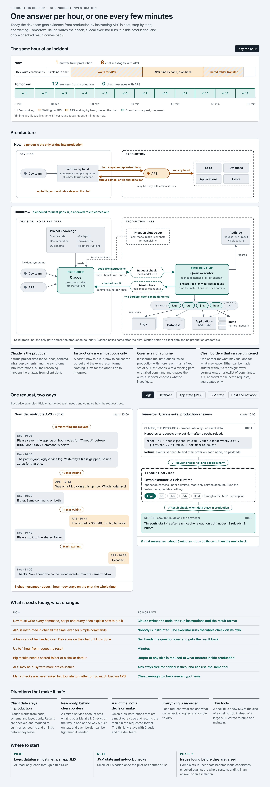

# Incident investigation: now vs tomorrow

A proposal for production support of SL3 incidents. It compares how the dev team gets evidence from production today with a proposed approach.

- **Now:** the dev team writes commands, scripts and queries by hand and instructs APS in chat, step by step. APS runs them manually. A round takes up to 1 hour.
- **Tomorrow:** Claude, working from project data only, produces code-like instructions. A local Qwen executor runs them inside production under a limited, read-only service account. Requests and results each pass a check, and only a filtered result leaves production. A round takes minutes.

Files:

- [`incident-flow.html`](incident-flow.html): the interactive page as one self-contained file. Open it in a browser; it needs no internet.
- [`incident-flow.png`](incident-flow.png): the full page as one picture.

Timings and examples are illustrative.

